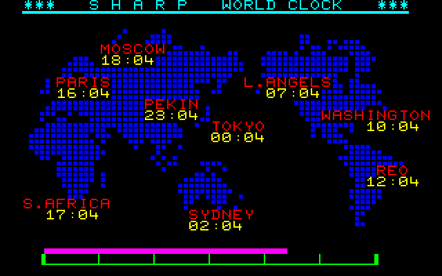
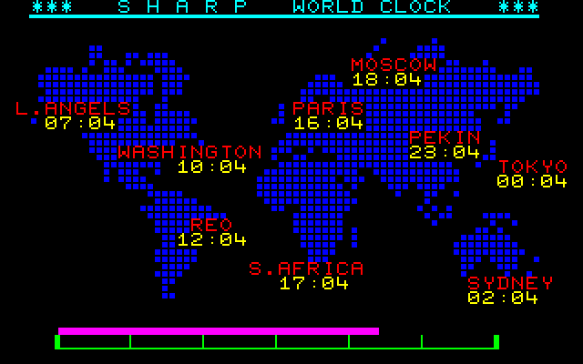
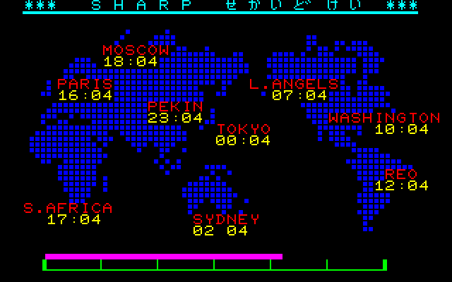
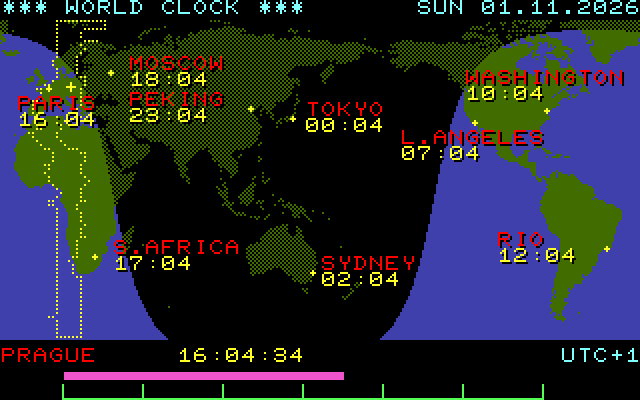
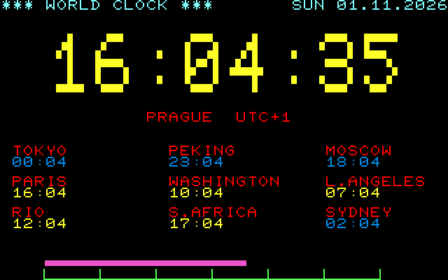
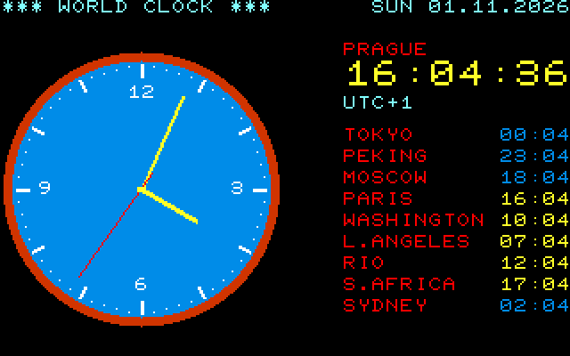

# World Clock pro Sharp MZ-700, MZ-800 a MZ-1500

Vzkříšené demo světových hodin „SHARP せかいどけい“ z inzerátů a katalogu Sharp MZ-700 (1982–83). Originální
program se nikdy nenašel, obrazovka je zrekonstruovaná z dobových fotek ([zdroje](docs/zdroje.md),
[rekonstrukce](docs/original.md)).

| | |
|---|---|
|  |  |
| Dobový vzhled, jak ho ukazoval katalog | Mezerník: Evropa uprostřed |
|  |  |
| Japonský MZ-700 a MZ-1500: titulek v hiraganě | MZ-800: mapa se dnem a nocí |
|  |  |
| MZ-800: digitální hodiny | MZ-800: ručičkové hodiny |

## Spuštění

- **Soubor** `worldclock.mzf` je v [Releases](https://github.com/mlukasek/MZ-WorldClock/releases). Nahrává se
  od 1200h a startuje na 2000h (kazeta, Unicard, emulátor).
- **Jeden program pro všechny stroje:** MZ-700 evropský i japonský, MZ-800 (v obou polohách přepínače SW1)
  a MZ-1500. Sám pozná, na čem běží.
- **MZ-800** má navíc grafickou mapu a hodiny. S rozšířením VRAM jsou v 16 barvách, bez něj ve 4.
- **Čas** se vezme z hodin karty Unicard (místní čas, Praha, na japonském stroji Tokio). Bez karty se program
  na datum, čas a pásmo zeptá. Časy měst jsou dnešní, včetně letního času.

## Ovládání

| Klávesa | Co dělá |
|---|---|
| mezerník | prohodí kontinenty (dobový vzhled a mapa) |
| `←` `→` | jen MZ-800: dobový vzhled ↔ mapa ↔ digitální hodiny ↔ ručičkové hodiny |
| `CR` | nastaví datum, čas a domovské pásmo |
| `BREAK` | konec, monitor má pak nastavené hodiny |

Po startu jsou klávesy chvíli vidět pod pravítkem.

## Překlad

z88dk (nightly) a Python 3: `build.cmd` vytvoří `build\worldclock.mzf`. Podrobnosti a testy v emulátoru jsou
v [docs/vyvoj.md](docs/vyvoj.md).

## Licence

GPL-3.0, viz [LICENSE](LICENSE). Sharp, MZ-700, MZ-800 a MZ-1500 jsou ochranné známky společnosti Sharp
Corporation. Projekt s ní nijak nesouvisí.
